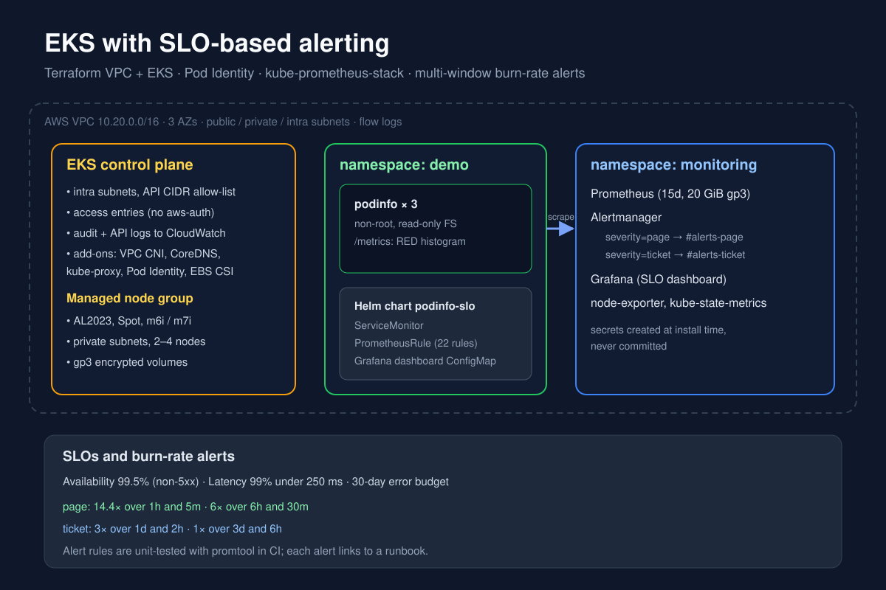

# EKS with SLO-based alerting

An EKS cluster built with Terraform and a monitoring stack that alerts on **error budgets** instead of raw thresholds. A demo service gets two SLOs, recording rules, multi-window burn-rate alerts that are unit-tested in CI, a Grafana dashboard and runbooks.



## Why burn-rate alerts

A static rule such as "error rate above 1% for 5 minutes" either pages on harmless blips or misses slow leaks. Burn-rate alerts ask a better question: **at this rate, how soon will we use up the month's error budget?** Following the Google SRE Workbook:

| Severity | Burn rate | Long window | Short window | Budget used before it fires |
|---|---|---|---|---|
| page | 14.4× | 1h | 5m | 2% |
| page | 6× | 6h | 30m | 5% |
| ticket | 3× | 1d | 2h | 10% |
| ticket | 1× | 3d | 6h | 10% |

The short window makes the alert resolve quickly once the problem stops.

## SLOs

| SLO | Target | Measured as |
|---|---|---|
| Availability | 99.5% over 30 days | requests that do not return 5xx |
| Latency | 99% over 30 days | requests served in under 250 ms |

Targets and the latency threshold are Helm values in [charts/podinfo-slo/values.yaml](charts/podinfo-slo/values.yaml); the rules are generated from them.

## What is in the repo

```
infra/                      Terraform: VPC (3 AZs, flow logs) + EKS 1.34
  main.tf                   managed node group (AL2023, Spot), EKS add-ons,
                            EBS CSI driver with Pod Identity, API CIDR allow-list
platform/
  kube-prometheus-stack.values.yaml   Prometheus, Alertmanager routing, Grafana
  storageclass-gp3.yaml               encrypted gp3 default StorageClass
  install.sh                          installs the stack and the demo app
charts/podinfo-slo/
  templates/app.yaml        podinfo, Service, ServiceMonitor, dashboard ConfigMap
  templates/slo-rules.yaml  14 recording rules + 8 burn-rate alerts
  dashboards/slo.json       Grafana: SLIs, budget left, burn rate, RED metrics
tests/slo_rules_test.yaml   promtool unit tests for the alerts
docs/runbooks.md            what to check and how to mitigate, linked from each alert
```

## Run it

Prerequisites: Terraform, AWS CLI, kubectl, Helm, an S3 bucket for state.

```bash
cp infra/backend.hcl.example infra/backend.hcl
cp infra/terraform.tfvars.example infra/terraform.tfvars   # set your IP in api_allowed_cidrs
make infra
make kubeconfig

export GRAFANA_ADMIN_PASSWORD='choose-one'
export SLACK_PAGE_WEBHOOK=...    # optional
export SLACK_TICKET_WEBHOOK=...  # optional
make platform

make load   # 5 minutes of traffic with 5% errors; the 1h page alert fires
```

Open Grafana with `kubectl -n monitoring port-forward svc/kps-grafana 3000:80` and find the **podinfo — SLOs** dashboard.

Tear down with `make destroy`.

## Tests and CI

```bash
make lint         # terraform fmt/validate, helm lint
make test-rules   # render rules, promtool check + unit tests
```

The unit tests feed synthetic traffic into Prometheus's rule engine and assert that 10% errors pages within the hour while 0.2% errors stays silent.

CI runs Terraform checks and Checkov, `helm lint`, the promtool tests, `kubeconform` schema validation of every rendered manifest (including the Prometheus Operator CRDs) and `shellcheck`.

## Security notes

- The Kubernetes API is public only to the CIDRs you list; `0.0.0.0/0` is rejected by a variable validation.
- Cluster access uses EKS access entries; the EBS CSI driver gets AWS permissions through Pod Identity, not node roles or keys.
- Grafana's admin password and the Slack webhooks are created as Kubernetes secrets at install time and are never committed.
- Workloads run as non-root with read-only filesystems and no Linux capabilities.
